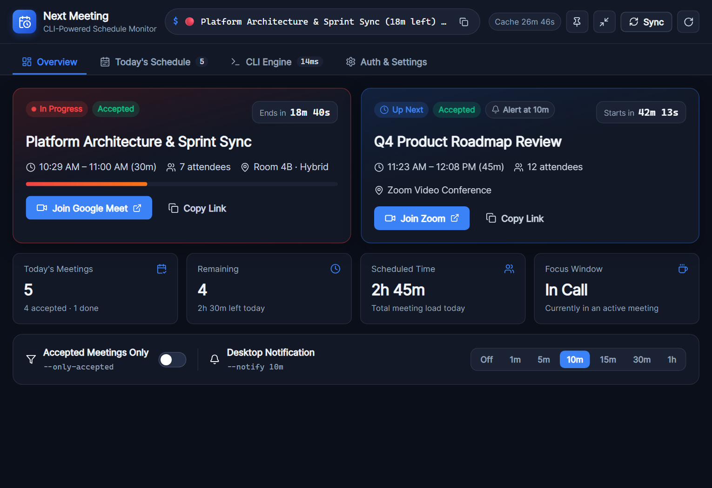
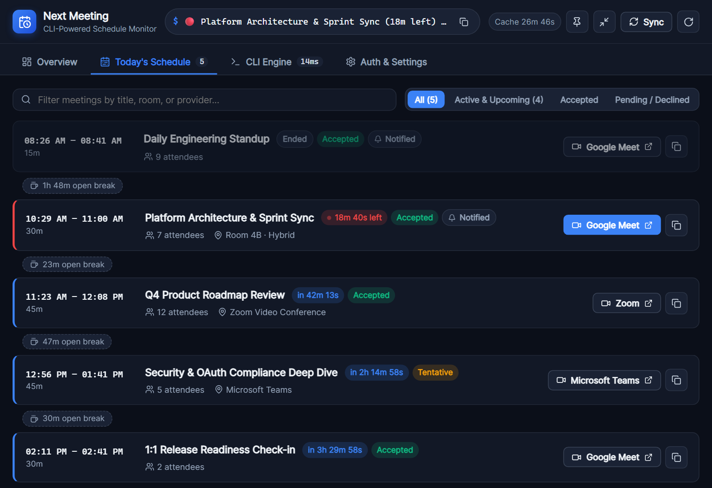
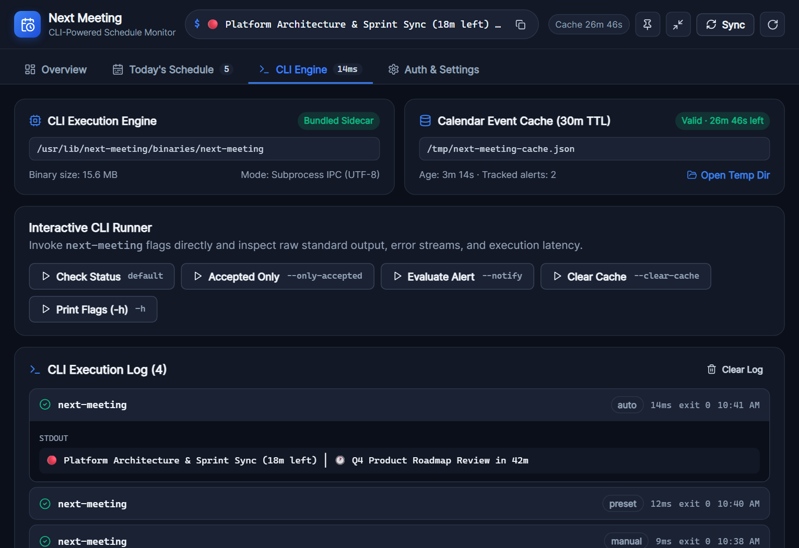
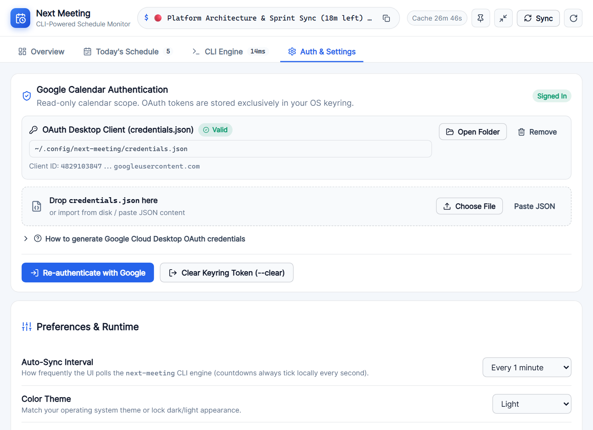
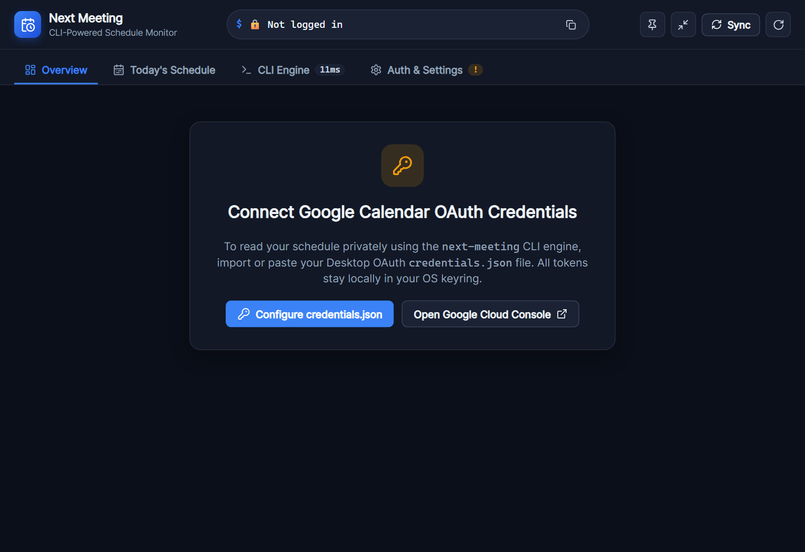
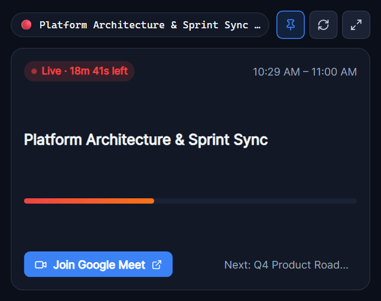

# next-meeting

A CLI tool and cross-platform interactive desktop application (built with **Tauri v2** and **Rust**) that displays your current or upcoming Google Calendar meeting status. Designed for status bars (like i3blocks, polybar, etc.), checking your schedule from the terminal, or monitoring your day from a lightweight native desktop app on **Windows, Linux, and macOS**.

## Features

### CLI (`next-meeting`)
- **Current Status**: Shows `🔴 [Meeting Name]` if you are currently in a meeting, with time remaining.
- **Upcoming Status**: Shows `🕐 [Meeting Name]` for the next meeting, with time until start.
- **Empty State**: Shows `📭 No meetings` if your schedule is clear.
- **Accepted Filter**: Optional `--only-accepted` flag to exclude declined or unconfirmed invites.
- **Desktop Notifications**: Optional `--notify <duration>` flag (e.g., `5m`, `15m`, `1h`) for upcoming meeting alerts.
- **Privacy**: Accesses your calendar in read-only mode. Credentials are stored securely in your system keyring.

### Desktop UI (`ui/` — Tauri + Rust)
- **CLI-Powered Execution Engine**: Bundles an optimized `next-meeting` sidecar binary (or connects to a custom CLI binary) and executes CLI commands natively without terminal flashes.
- **Live Focus & Countdown Dashboard**: Real-time 1-second local countdowns, active meeting progress bar, daily meeting load metrics, and 1-click **Join** buttons for Google Meet, Zoom, Microsoft Teams, and Webex links.
- **Interactive Today's Timeline**: Chronological schedule view with search, RSVP status filtering, conflict/overlap badges, and open focus-time gap indicators.
- **System Tray & Compact Desk Widget**: Native tray/menu bar integration showing live meeting status, quick join action, minimize-to-tray support, always-on-top pinning, and a compact floating mini-widget mode.
- **Built-in OAuth & Credentials Manager**: Drag-and-drop or paste `credentials.json` with instant schema validation, plus real-time `next-meeting --login` browser flow with cancellation support.
- **Interactive CLI Console**: Run CLI presets directly (`--only-accepted`, `--notify`, `--clear-cache`, `-h`) and inspect raw `stdout`/`stderr`, exit codes, cache TTL, and execution latency.

## Desktop UI Preview

| Live Focus Dashboard | Interactive Today's Timeline |
| :---: | :---: |
|  |  |
| **CLI Engine Console & Execution Telemetry** | **Auth, Tray & Light Theme Settings** |
|  |  |
| **Guided OAuth Onboarding** | **Always-on-Top Compact Widget** |
|  |  |

## Prerequisites

- **Go**: Required to build the CLI (and automatically invoked by Cargo's `build.rs` when compiling the bundled sidecar).
- **Google Cloud Platform Project**: A project with the **Google Calendar API** enabled to generate your own `credentials.json`.
- **For Desktop UI Development**:
  - **Rust** (stable toolchain via `rustup`)
  - **Node.js** (LTS) & `npm`
  - Platform WebView dependencies (WebView2 on Windows, WKWebView on macOS, `libwebkit2gtk-4.1-dev` & `libayatana-appindicator3-dev` on Ubuntu/Debian Linux).

## Installation & Setup

### 1. Clone the Repository

```bash
git clone https://github.com/jadolg/next-meeting.git
cd next-meeting
```

### 2. Configure Google Credentials

To allow `next-meeting` to access your calendar, you need to create an OAuth 2.0 Client ID in the Google Cloud Console.

1. Go to the [Google Cloud Console](https://console.cloud.google.com/).
2. Create a new project or select an existing one.
3. Enable the **Google Calendar API** for your project.
4. Go to **APIs & Services** > **Credentials**.
5. Click **Create Credentials** > **OAuth client ID**.
6. Select **Desktop app** as the Application type.
7. Name it (e.g., "Next Meeting CLI").
8. Download the JSON file.
9. Either import/drop the file directly inside the **Next Meeting Desktop UI** (*Auth & Settings* tab), or rename it to `credentials.json` and move it to your system's configuration directory:

   | OS      | Path                                                          |
   |---------|---------------------------------------------------------------|
   | Linux   | `~/.config/next-meeting/credentials.json`                     |
   | macOS   | `~/Library/Application Support/next-meeting/credentials.json` |
   | Windows | `%APPDATA%\next-meeting\credentials.json`                     |

   For example, on Linux:
   ```bash
   mkdir -p ~/.config/next-meeting
   mv /path/to/downloaded-file.json ~/.config/next-meeting/credentials.json
   ```

### 3. Build the CLI

Run `go build` to compile the standalone CLI binary:

```bash
go build -o next-meeting
```

### 4. Run or Build the Desktop UI

Install frontend dependencies and launch the Tauri development app (Cargo's `build.rs` automatically compiles the stripped Go sidecar binary for your target architecture):

```bash
cd ui
npm install
npm run tauri dev
```

To build optimized native installers for your current OS (`.msi` / `.exe` on Windows, `.dmg` / `.app` on macOS, `.deb` / `.rpm` / `.AppImage` on Linux):

```bash
cd ui
npm run tauri build
```

## CLI Usage

### Authentication

First, log in to authorize read-only access to your calendar data:

```bash
./next-meeting --login
```

This will:
1. Print an authorization URL.
2. Attempt to open it in your default browser.
3. Once you approve access, store the token securely in your system's keyring.

### Checking Status

Once logged in, run the binary:

```bash
./next-meeting
```

Optional flags:
- `./next-meeting --only-accepted` — Only include accepted or tentative meetings.
- `./next-meeting --notify 10m` — Send a desktop notification if the next meeting starts within `10m`.
- `./next-meeting --clear-cache` — Clear the 30-minute local calendar cache and notification state.
- `./next-meeting --clear` — Remove the stored OAuth token from your system keyring.

**Example Outputs:**
- `🔴 Weekly Sync (5m left) │ 🕐 Lunch in 1h 5m`
- `🕐 Team Standup in 10m`
- `📭 No meetings`

## Desktop UI Keyboard Shortcuts

- `Ctrl/Cmd + R`: Sync schedule via CLI engine
- `Ctrl/Cmd + Shift + R`: Clear cache (`--clear-cache`) and force fresh API sync
- `Ctrl/Cmd + J`: Join active or next upcoming video meeting
- `1` / `2` / `3` / `4`: Switch between *Overview*, *Today's Schedule*, *CLI Engine*, and *Auth & Settings*

## CI/CD & Automated Releases

- **CI (`.github/workflows/build.yml`)**: Validates both the Go CLI (`go build`, `go test`) and the Tauri + Rust Desktop UI (`tsc`, `vite build`, `cargo clippy`, `cargo test` including sidecar integration tests).
- **Release (`.github/workflows/release.yml`)**: Automated **SemVer** release pipeline triggered on `main` pushes (analyzing Conventional Commits for `major`, `minor`, or `patch` bumps), manual `workflow_dispatch` (with `auto`, `patch`, `minor`, `major`, or `custom` SemVer selection), or manual GitHub Releases. Automatically tags the release, runs **GoReleaser** for standalone CLI archives, and executes a cross-platform **Tauri Release Matrix** (`linux-x86_64`, `windows-x86_64`, `macos-aarch64`, `macos-x86_64`) that attaches native desktop UI installers to the same GitHub Release.

## Troubleshooting

- **Authorization Server**: The `--login` command starts a local server on port `8085` to receive the callback from Google. Ensure this port is not in use (in the Desktop UI you can cancel an active login attempt at any time).
- **Keyring Issues**: If you encounter issues saving the token, ensure you have a working system keyring (e.g., `gnome-keyring` on Linux, Keychain on macOS, Credential Manager on Windows).
